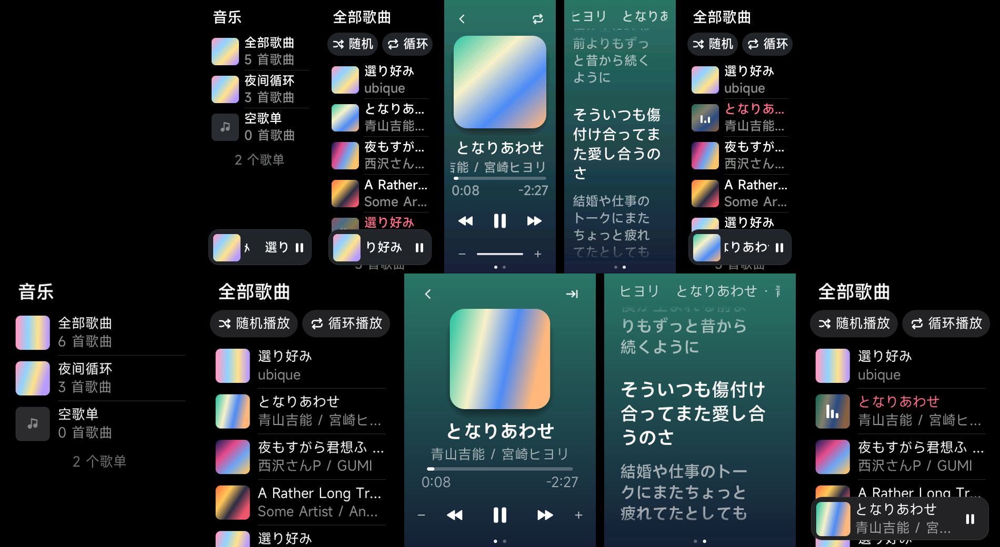

# 截图

Mirage 模拟器里的截图，不是真机。由 `scripts/mirage_screenshots.py KEY docs/screenshots` 在已部署当前构建的设备上生成
（`mirage_session.py KEY deploy --seed 4` 之后）；`KEY` 是 `155`、`179`（Band 11，212×520）或 `043`（Band 10 Pro，336×480）。
曲库是脚本灌入的示例歌（颜色是合成的封面），带两个歌单：“夜间循环”（3 首，按它自己的顺序）和一个空歌单。
`.043`、`.155` 的图是 2026-10-24 在 Canopus ABI 2.0 的 Supervisor 上重拍的；`.179` 的图还是歌单之前的版本（没有主页，
“曲库”就是第一页），没有重拍。

上排 Band 11 `.155`，下排 Band 10 Pro `.043`：主页（全部歌曲和歌单）、歌曲页（带随机/循环播放按钮）、播放页、歌词页、
播放中的歌曲页（底部迷你播放条，当前行带律动条）。

| 文件 | 内容 |
|---|---|
| `<KEY>-launcher.png` | 启动器里的 Lyra 图标（Band 10 Pro 的图标在末行首格，被系统启动器裁掉一部分） |
| `<KEY>-home.png` | 主页：“全部歌曲”和各个歌单，每行是第一首有封面的歌的封面、名称和歌曲数 |
| `<KEY>-library.png` | “全部歌曲”页：随机播放、循环播放两个按钮，下面是封面缩略图、歌名与艺人，末尾是歌曲数 |
| `<KEY>-player.png` | 播放页 |
| `<KEY>-volume.png` | 点两次音量减后的显示（Band 11 是底部音量条，Band 10 Pro 临时替换标题行） |
| `<KEY>-lyrics.png` | 歌词页，自动跟随，当前行高亮 |
| `<KEY>-lyrics-browse.png` | 手指拖动歌词后的浏览状态 |
| `<KEY>-library-playing.png` | 返回歌曲页：当前行歌名变色、封面上有律动条，底部浮着迷你播放条 |

空曲库的提示页没有放进来：脚本的 `--empty` 选项可以生成，但这批截图之后又改了提示文案，没有重拍。
